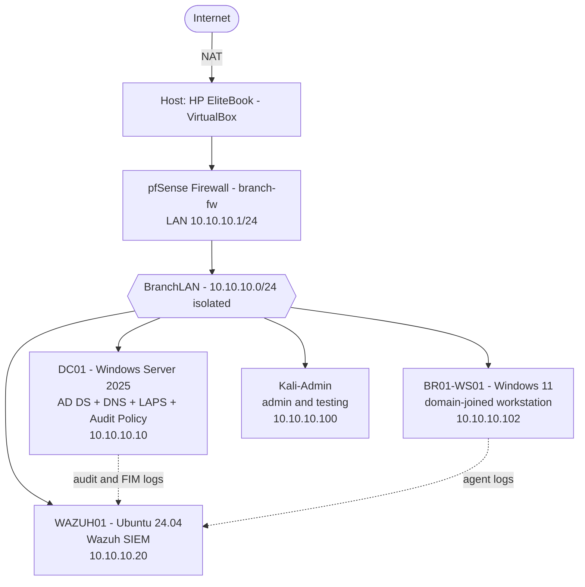

# Bank Branch Security Lab

A virtual bank-branch network, built from the ground up to design, harden, attack, and monitor a small enterprise environment. Firewall to SIEM, every layer built by hand and verified.

> Built in a home lab on isolated virtual machines. No real systems, no real customer data. All user accounts and data are synthetic.

---

## Overview

This project simulates the IT environment of a single bank branch and the security controls that protect it. I built it one layer at a time: a firewalled network, an Active Directory domain, a managed workstation, hardening policies, and a full detection stack. Then I attacked it to prove the detection actually works.

The goal was to get hands-on with the day-to-day work of a bank Tech Ops / blue team role: identity and access, Group Policy, credential protection, log collection, and alerting.

---

## Architecture



---

## Tech stack

| Area | Tools |
|---|---|
| Virtualization | Oracle VirtualBox |
| Firewall / network | pfSense, segmented internal LAN, DHCP, DNS forwarding |
| Identity | Windows Server 2025, Active Directory, DNS, Group Policy |
| Endpoint | Windows 11 Enterprise, domain join |
| Credential protection | Windows LAPS (encrypted AD backup, rotation) |
| Monitoring | Wazuh SIEM (indexer, manager, dashboard), agents |
| Detection | Advanced audit policy, file integrity monitoring |
| Offensive testing | Kali Linux, PowerShell attack simulation |
| Scripting | PowerShell, Bash |

---

## How it was built

Each phase builds on the one before it. Full write-ups for every phase are in [`/docs/reports`](docs/reports).

### Phase 1 — Perimeter
Set up a pfSense firewall with an isolated internal network (BranchLAN, 10.10.10.0/24) behind it, plus a Kali Linux admin and testing box. Hardened the firewall defaults and confirmed segmentation.

### Phase 2 — Identity
Built a Windows Server 2025 domain controller, stood up Active Directory for the domain `jrbankna.internal`, and configured DNS. Designed an OU structure for a branch with role-based security groups for tellers, managers, and IT, plus a separate privileged admin account.

### Phase 3 — Endpoints
Built a Windows 11 Enterprise workstation and joined it to the domain, so a staff account logs in and lands on a managed PC.

### Phase 4 — Hardening
Applied a domain password policy and an account lockout policy, a workstation baseline GPO (including idle-screen lock), and a file share with NTFS permissions scoped per group so each role sees only what it should. Least privilege, enforced.

### Phase 5 — Detection foundation
Deployed **Windows LAPS** so every machine has its own rotating local admin password, backed up encrypted to Active Directory. Turned on an advanced **audit policy** across the domain controller and workstation, then stood up a **Wazuh SIEM** on Ubuntu with agents reporting from both Windows machines. Verified a failed logon surfaced as an alert within seconds.

### Phase 6 — Detection in action
Ran a **brute-force attack** against a user account from a domain-joined workstation. The lockout policy stopped it, and Wazuh escalated the burst to a **high-severity alert (rule 60115, level 9)** that identified the source machine of the attack. Then added **real-time file integrity monitoring** on the file share and confirmed alerting on file add, modify, and delete.

---

## Detection highlights

A few results that show the stack working end to end. Screenshots in [`/docs/screenshots`](docs/screenshots).

- **Brute force caught and escalated.** Ten failed logons tripped the lockout policy; Wazuh raised a level-9 "account locked out (multiple logon failures)" alert naming the attack's source machine.
- **Log correlation across hosts.** A failed logon produced matching events on both the workstation (4625) and the domain controller (4771), correlated by synchronized timestamps.
- **File integrity monitoring.** Creating, changing, and deleting a file each produced its own alert (rules 554, 550, 553) in real time, the early-warning pattern for ransomware.
- **Command-line visibility.** Process-creation logging captures the full command line, not just that a program ran.

---

## Skills demonstrated

- Active Directory design: OUs, role-based security groups, privileged account separation
- Group Policy: password and lockout policy, security baselines, drive mapping
- Credential protection with Windows LAPS and just-in-time admin rights
- SIEM deployment and agent management (Wazuh)
- Windows audit policy and Security event analysis by event ID
- File integrity monitoring configuration and tuning
- Firewall and network segmentation (pfSense)
- Attack simulation and detection validation (purple-team workflow)
- Troubleshooting across the hypervisor, Group Policy, SMB, and Windows internals
- PowerShell and Linux administration

---

## Repository structure

```
.
├── README.md
├── docs/
│   ├── reports/          # Full session reports (PDF)
│   ├── screenshots/      # Dashboard and terminal captures
│   └── diagrams/         # Network and architecture diagrams
├── configs/              # Sanitized configuration notes and snippets
│   ├── active-directory.md
│   ├── group-policy.md
│   ├── laps.md
│   ├── audit-policy.md
│   └── wazuh-fim.md
└── scripts/              # Sanitized PowerShell used in the lab
```

---

## Roadmap

- [x] Perimeter, identity, endpoints, hardening
- [x] LAPS, audit logging, Wazuh SIEM
- [x] Brute-force detection and file integrity monitoring
- [ ] Self-hosted AI assistant for a banking use case (local model + MCP tool, synthetic data)
- [ ] Automation: scripts for routine checks and reporting

---

## A note on safety

Everything here runs on isolated VMs with invented data. Account names are fictional, no real credentials or customer information appear anywhere in this repo, and nothing is exposed to the internet. The point is to practice real controls safely.
